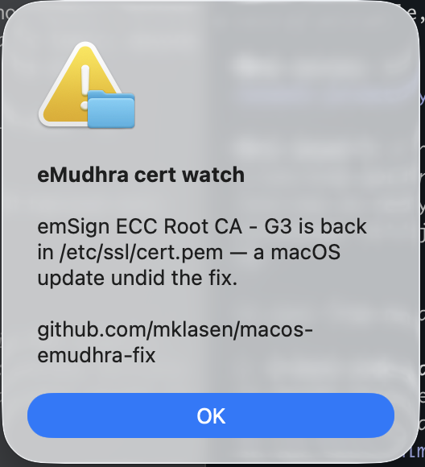

# Optional watcher

A macOS update can replace `/etc/ssl/cert.pem` with Apple's current version and silently put the removed roots back. This LaunchAgent checks once a day and raises an alert if that happens. It is read-only, runs no `sudo`, and never modifies anything — it only tells you to re-run the steps.

Most people don't need it. "Re-run step 1 after a macOS update" does the same job for free. This is for machines you won't be watching.

## It only looks for `emSign ECC Root CA - G3`

Deliberately — not `AAA Certificate Services`, even though [step 4](../README.md) recommends removing that one too.

Apple kept the AAA root months after Chrome and Mozilla dropped it, and may well keep it through this fix. If Apple's updated bundle still ships AAA, a watcher looking for it would fire every single day, forever, for everyone who followed step 4 — reporting Apple's deliberate choice as a regression.

`emSign ECC Root CA - G3` carries no such ambiguity. Apple will remove it, Mozilla emergency-distrusted it, and it has no legitimate reason to reappear. If it comes back, an update definitely overwrote your work.

The trade-off: the watcher tells you an update clobbered the file, but you still have to re-run step 4 yourself, since it isn't tracking that root.

## Why a modal alert and not a notification

The obvious implementation uses `display notification`. **It doesn't work.** Notifications from `osascript` are attributed to Script Editor, and macOS silently discards them unless that app has been granted notification permission — which it has not been on a stock machine, and nothing ever prompts for it. `osascript` still exits `0`, so the watcher reports success while telling you nothing.

For a check that is silent 364 days a year, failing silently on the one day it matters defeats the entire purpose. `display alert` needs no permission and cannot be missed:



The alert deliberately contains no commands. It may surface months from now with no surrounding context, and a modal whose first instruction is `sudo rm` invites someone to delete their backup and stop reading. It states what happened and links here.

If it fires: `sudo rm /etc/ssl/cert.pem.orig` to clear the stale backup — step 2 won't overwrite an existing one — then repeat steps 2-4.

## Install

```bash
mkdir -p ~/.local/bin ~/Library/LaunchAgents
cp emudhra-watch.sh ~/.local/bin/ && chmod +x ~/.local/bin/emudhra-watch.sh
sed "s|__HOME__|$HOME|" emudhra-watch.plist > ~/Library/LaunchAgents/com.local.emudhra-watch.plist
launchctl load ~/Library/LaunchAgents/com.local.emudhra-watch.plist
```

The `sed` fills in your home directory, since a `.plist` can't contain `~`.

`RunAtLoad` means it checks immediately. **Silence is the success signal** — it only speaks up when a root has come back.

macOS will tell you once that a background item was added. It names the script, `emudhra-watch.sh`, because the agent points at a real file rather than `/bin/sh` — a plist invoking `/bin/sh` directly gets announced as a generic "sh", which is both uninformative and alarming.

## Test it before trusting it

Your backup from step 2 still contains both roots, so it exercises the alert path without touching anything:

```bash
EMUDHRA_BUNDLE=/etc/ssl/cert.pem.orig ~/.local/bin/emudhra-watch.sh
```

That should raise the alert. Running it with no `EMUDHRA_BUNDLE` set should stay silent on a fixed machine.

## Uninstall

```bash
launchctl unload ~/Library/LaunchAgents/com.local.emudhra-watch.plist
rm ~/Library/LaunchAgents/com.local.emudhra-watch.plist ~/.local/bin/emudhra-watch.sh
```

**Remove it once Apple's fix ships.** After that it is dead weight — a background job checking for a problem the OS has already solved.
